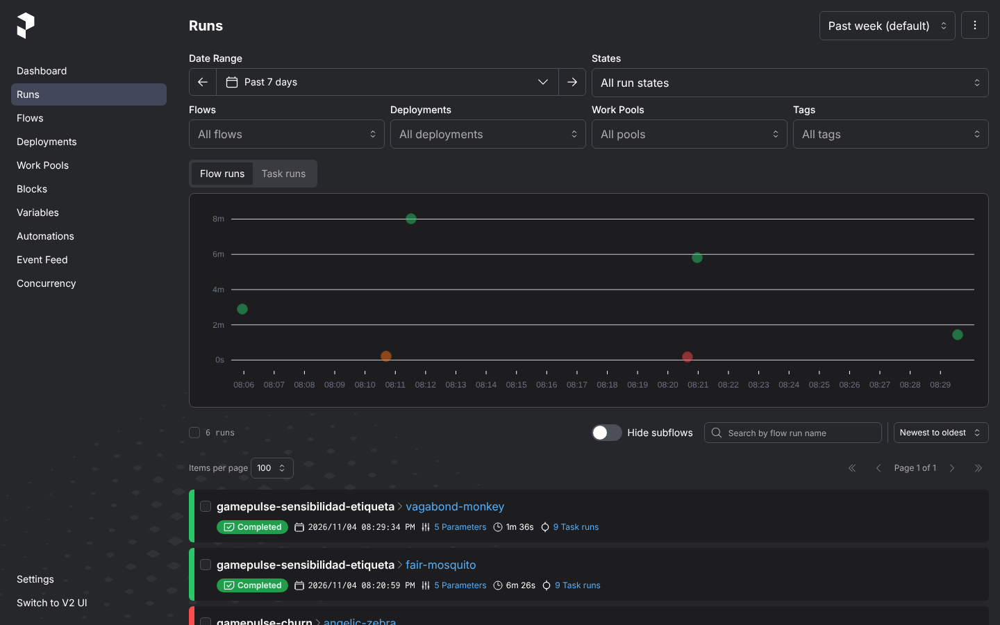
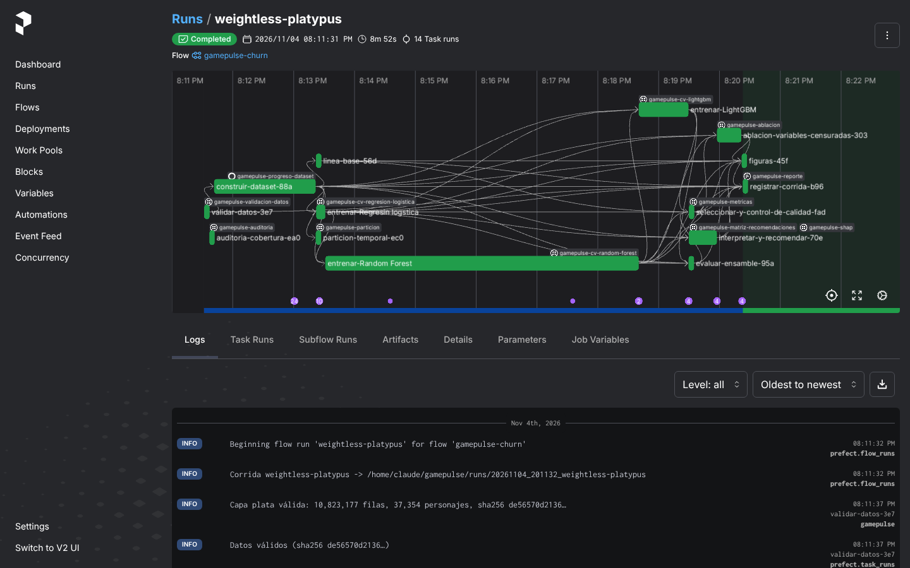
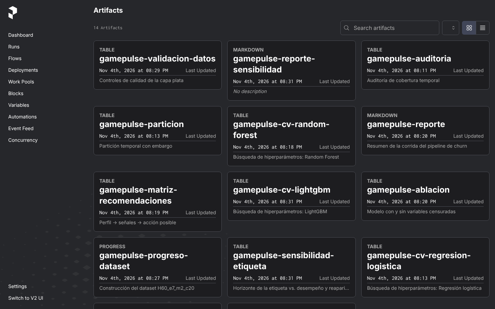
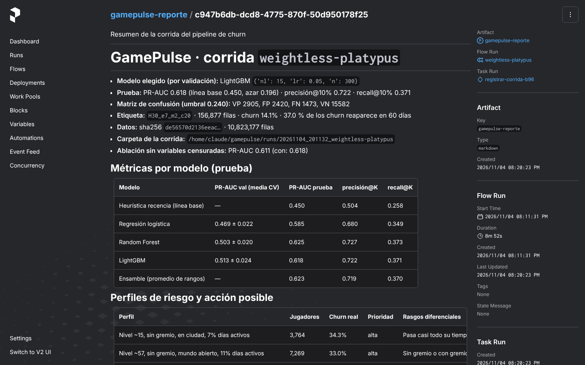
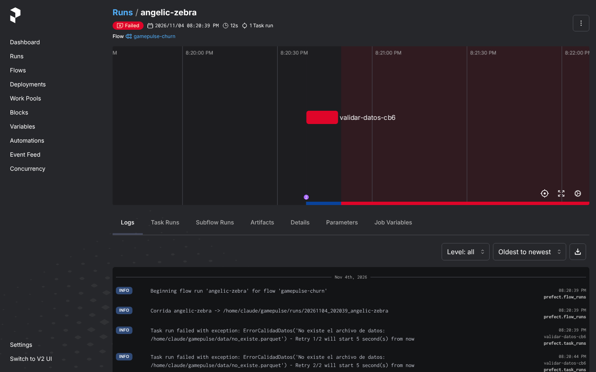

# GamePulse · Ejecución con Prefect, paso a paso

Prefect orquesta el pipeline de churn: cada etapa es una **tarea** con su estado, duración y logs, y cada
ejecución completa es una **corrida de flujo** (flow run) que queda registrada en un **dashboard web**.
Ahí se ve si la corrida terminó bien, en qué tarea falló y por qué, los logs de cada paso y las tablas de
resultados (métricas, matriz de recomendaciones, etc.).

## 0. Qué hay en el flujo `gamepulse-churn`

| # | Tarea en el dashboard | Qué hace | Si falla… |
|---|---|---|---|
| 1 | `validar-datos` | Revisa columnas, tipos, nulos, duplicados, rangos de nivel y fechas; calcula el SHA-256 del parquet | Se detiene con `ErrorCalidadDatos` (se reintenta 2 veces por si el archivo estaba bloqueado) |
| 2 | `auditoria-cobertura` | Días sin cobertura, cadencia del colector, huecos, tasa de retorno | — |
| 3 | `construir-dataset` | Etiqueta + 37 variables por personaje y corte. **Se reutiliza** si ya existe uno con el mismo hash de datos y la misma configuración | Límite de 1 hora |
| 3b | `leer-oro` | Sólo con `--oro`: usa la tabla que construyó Spark en AWS en lugar de `construir-dataset` | Se detiene si las columnas no coinciden |
| 4 | `particion-temporal` | Arma los bloques entrenamiento / validación / prueba y los 3 bloques de origen móvil, y **verifica que no haya fuga** | Se detiene con `ErrorFugaTemporal` |
| 5 | `linea-base` | Regla de recencia sin aprendizaje (referencia mínima) | — |
| 6 | `entrenar-Regresión logística`, `entrenar-Random Forest`, `entrenar-LightGBM` | Búsqueda de hiperparámetros con origen móvil, umbral en validación, reentreno y evaluación en prueba | Se reintenta 1 vez |
| 7 | `evaluar-ensamble` | Promedio de rangos de los 3 modelos: ¿mejora a cada uno por separado? | — |
| 8 | `seleccionar-y-control-de-calidad` | Elige el modelo por validación (nunca por la prueba) | Se detiene con `ErrorCalidadModelo` si no supera a la línea base |
| 9 | `interpretar-y-recomendar` | SHAP, perfiles K-Means, matriz de recomendaciones, señales y acción por jugador | — |
| 10 | `analizar-poblacion` | Embudo de la población por corte, jugadores nunca vistos, desempeño por subpoblación, modelos especializados | — |
| 10b | `ablacion-variables-censuradas` | Mismo modelo y mismos hiperparámetros, con y sin las variables que dependen del inicio del dataset; compara en validación (`ablacion_controlada.csv`) | — |
| 10c | `variables-individuales` | Una regresión logística por variable en los bloques de validación; ranking por ROC-AUC (`variables_individuales_cv.csv`) | — |
| 11 | `figuras` | Figuras PNG para el informe (fig1–fig5 y fig9, curvas ROC; `analizar-poblacion` agrega fig7 y fig8) | — |
| 12 | `registrar-corrida` | Guarda modelos, ficha de la corrida, historial y el reporte en markdown | — |

## 1. Instalar (una sola vez)

Requisitos: Python 3.10 o superior, ~8 GB de RAM.

```bash
cd gamepulse-pi
python -m venv .venv
# Windows:            .venv\Scripts\activate
# Mac / Linux:        source .venv/bin/activate
pip install -e ".[dev]"          # instala el paquete gamepulse_ml, Prefect y pytest
pytest -q                        # 13 pruebas con datos sintéticos (~10 s)
```

La capa plata ya viene en `data/plata_wowah.parquet` (origen y verificación en `data/README.md`).

## 2. Levantar el servidor y el dashboard

En una **primera terminal** (déjenla abierta mientras trabajan):

```bash
prefect server start
```

Abran **http://127.0.0.1:4200** en el navegador. Ese es el dashboard.

En una **segunda terminal**, una sola vez, indiquen a Prefect que use ese servidor:

```bash
prefect config set PREFECT_API_URL=http://127.0.0.1:4200/api
```

> Sin este paso el flujo también corre, pero en un servidor temporal que se apaga al terminar.

## 3. Ejecutar el pipeline

Desde la segunda terminal, en la raíz del repositorio:

```bash
python flows/pipeline_flow.py
```

Tarda ~10–15 minutos la primera vez (construye el dataset y prueba 10 configuraciones de modelos en 3 bloques)
y ~8–12 minutos las siguientes (reutiliza el dataset). Opciones útiles:

```bash
python flows/pipeline_flow.py --n-folds 1                    # más rápido: solo el bloque de validación
python flows/pipeline_flow.py --familias LightGBM            # un solo modelo
python flows/pipeline_flow.py --horizonte-dias 45            # otra definición de la etiqueta
python flows/pipeline_flow.py --reconstruir-dataset          # ignorar el dataset guardado
python flows/pipeline_flow.py --oro data/oro                # tabla de modelado construida con Spark (aws/GUIA_PASO_A_PASO.md, 5b)
```

## 4. Revisar la corrida en el dashboard



1. **Runs** (menú izquierdo): cada corrida aparece con un nombre aleatorio (p. ej. `amber-heron`) y su estado:
   verde **Completed**, rojo **Failed**, amarillo **Running/Retrying**. Ahí se filtra por estado, flujo o fecha.
2. Al abrir una corrida:
   - **Gráfico de tareas** (arriba): una barra por tarea con su duración; la que falló aparece en rojo.
   - **Logs**: todo lo que escribió cada tarea, incluidos los mensajes del paquete (`gamepulse - Corte 2008-03-03 -> ok…`).
     Se filtran por nivel (INFO, WARNING, ERROR). Si algo falla, aquí está el traceback completo.
   - **Task Runs**: lista de tareas con estado, intentos y duración. Clic en una tarea = sus logs solos.
   - **Artifacts**: las tablas y reportes que deja la corrida (ver abajo).
   - **Parameters**: los parámetros exactos con que se ejecutó (horizonte, folds, familias…).


3. **Artifacts** (menú izquierdo) agrupa por clave; cada clave guarda el historial de todas las corridas:

| Clave | Contenido |
|---|---|
| `gamepulse-reporte` | Resumen en markdown: modelo elegido, métricas, matriz de confusión, perfiles y acciones |
| `gamepulse-metricas` | Tabla de modelos: PR-AUC (validación con origen móvil y prueba), precisión@K, recall@K, Brier… |
| `gamepulse-validacion-datos` | Controles de calidad y hash de los datos |
| `gamepulse-auditoria` | Indicadores clave de la auditoría de cobertura |
| `gamepulse-particion` | Bloques temporales, fechas y tasa de churn de cada uno |
| `gamepulse-cv-<modelo>` | PR-AUC de cada configuración de hiperparámetros por bloque |
| `gamepulse-shap` | Importancia global de variables |
| `gamepulse-matriz-recomendaciones` | Perfil → prioridad → rasgos → acción posible |
| `gamepulse-ablacion` | Modelo con y sin variables censuradas (mismos hiperparámetros; PR-AUC en validación y en prueba) |
| `gamepulse-variables-individuales` | Las 10 variables que mejor predicen por separado (ROC-AUC en validación) |
| `gamepulse-poblacion` | Embudo de la población (promedio por corte) y estructura del panel |
| `gamepulse-subpoblaciones` | Desempeño del modelo por subpoblación en prueba |
| `gamepulse-modelos-especializados` | Un modelo por subpoblación frente al modelo global |
| `gamepulse-progreso-dataset` | Barra de progreso de la construcción del dataset |
| `gamepulse-sensibilidad-etiqueta`, `gamepulse-reporte-sensibilidad` | Resultados del flujo de sensibilidad |





## 5. Dónde quedan los archivos (trazabilidad fuera de Prefect)

```
runs/
├── registro_ejecuciones.csv     # una fila por corrida: fecha, id de Prefect, hash de datos, modelo, métricas
├── ultima_corrida.txt           # ruta de la corrida más reciente
├── fallos.log                   # corridas fallidas (lo escribe el hook on_failure)
├── auditoria/                   # salidas de la auditoría
├── cache/                       # datasets construidos, uno por configuración de etiqueta
└── 20261104_201130_<nombre>/    # una carpeta por corrida
    ├── parametros.json
    ├── ficha_corrida.json       # id y enlace de Prefect, commit git, versiones de librerías, hash de datos, métricas
    ├── resultados_modelos.csv
    ├── desempeno_por_corte_prueba.csv
    ├── scores_prueba.parquet    # riesgo por jugador y corte, segmento, 3 señales, acción sugerida, prioridad top-K
    ├── matriz_recomendaciones.csv, catalogo_senales_acciones.csv
    ├── importancia_shap_prueba.csv, perfiles_kmeans_prueba.csv, kmeans_diagnostico_k.csv
    ├── ablacion_controlada.csv, variables_individuales_cv.csv
    ├── modelos/*.joblib         # cada modelo con sus columnas, hiperparámetros, umbral y metadatos
    └── figuras/*.png
```

Con `scores_prueba.parquet` se arman las tablas que publica AWS y lee el tablero (`aws/api/preparar_publicacion.py`).

Cargar un modelo guardado:

```python
import joblib
m = joblib.load("runs/<carpeta>/modelos/lightgbm.joblib")
riesgo = m["modelo"].predict_proba(X[m["columnas"]])[:, 1]      # X con las mismas columnas del dataset
```

## 6. Sensibilidad de la etiqueta y de la población (flujo aparte)

```bash
python flows/sensibilidad_flow.py                       # 6 escenarios (~5 min si los datasets ya existen)
python flows/sensibilidad_flow.py --horizontes 30 45    # solo esos horizontes con la población base
```

Escenarios: horizontes de 21, 30, 45 y 60 días con la población base, y dos poblaciones alternativas con 30 días
(activos en 14 días; incluir personajes de un solo día). Para cada uno reconstruye el dataset y entrena LightGBM.
Además de la PR-AUC en su propia población, mide la **PR-AUC sobre la población base**, que es la comparación
justa: una población más amplia agrega casos fáciles e infla la métrica. Deja la tabla
`gamepulse-sensibilidad-etiqueta` y la figura `fig6_sensibilidad_etiqueta.png`. Con horizontes largos el bloque de
prueba tiene menos cortes (los datos terminan el 31/12/2008).

## 7. Despliegue programado (escenario de implementación real)

```bash
python flows/desplegar.py
```

Registra tres deployments y deja el proceso escuchando (no cierren esa terminal):

- `gamepulse-churn/semanal`: todos los lunes a las 03:00 (Bogotá), como un reentrenamiento en producción.
- `gamepulse-churn/manual` y `gamepulse-sensibilidad-etiqueta/manual`: se lanzan desde el dashboard.

En **Deployments** pueden usar **Run → Quick run** (parámetros por defecto) o **Custom run** (cambiar el
horizonte, los folds, las familias…). Las corridas lanzadas así aparecen en **Runs** igual que las manuales.

## 8. Comprobar que los errores se ven en el dashboard

```bash
python flows/pipeline_flow.py --src data/no_existe.parquet --sin-auditoria
```

La corrida queda en rojo (**Failed**). La tarea `validar-datos` muestra 3 intentos (los 2 reintentos) y en
**Logs** aparece `ErrorCalidadDatos: No existe el archivo de datos`. También se agrega una línea en `runs/fallos.log`.



Una corrida interrumpida a mitad (Ctrl+C, apagado del equipo) aparece como **Crashed** (naranja).

## 9. Problemas frecuentes

| Síntoma | Solución |
|---|---|
| `Connection refused` al ejecutar el flujo | El servidor no está levantado (paso 2) o falta `prefect config set PREFECT_API_URL=...` |
| El puerto 4200 está ocupado | `prefect server start --port 4300` y `prefect config set PREFECT_API_URL=http://127.0.0.1:4300/api` |
| `ModuleNotFoundError: gamepulse_ml` | Instalen el paquete con `pip install -e .` o ejecuten desde la raíz del repositorio |
| La corrida tarda mucho | `--n-folds 1` o `--familias LightGBM`; Random Forest es el modelo más lento |
| Quiero volver a empezar | `prefect server database reset -y` borra el historial del dashboard; borren `runs/` para los archivos |

## 10. Usar el paquete sin Prefect

La lógica vive en el paquete y no depende de Prefect: se puede importar desde un notebook
(`from gamepulse_ml import dataset`). Prefect solo la orquesta y registra.
