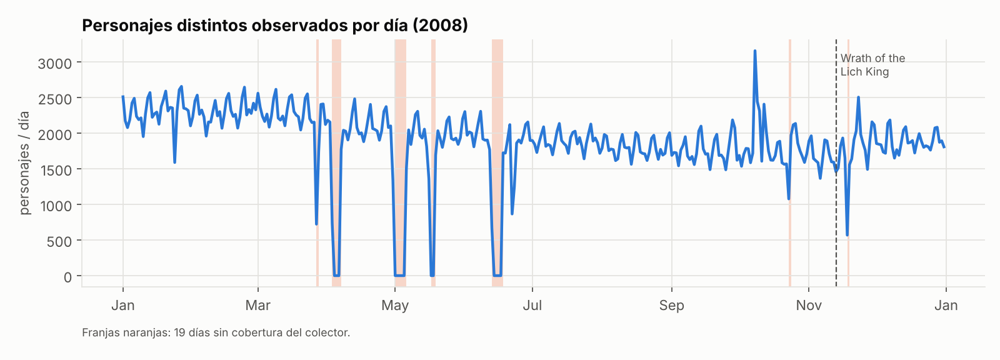
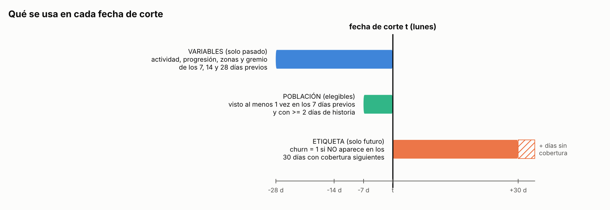
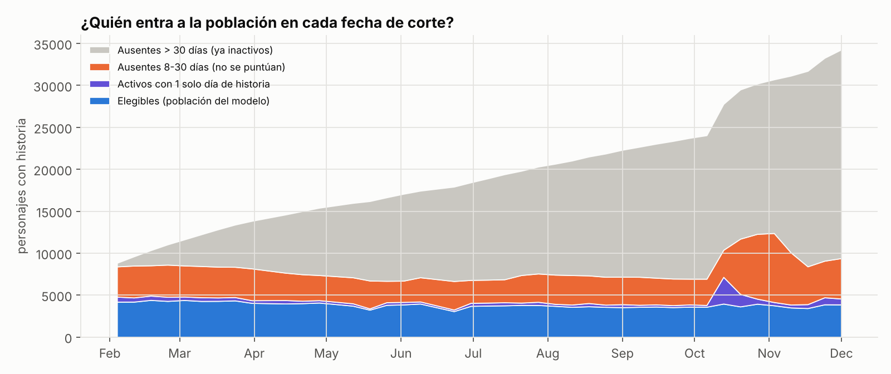
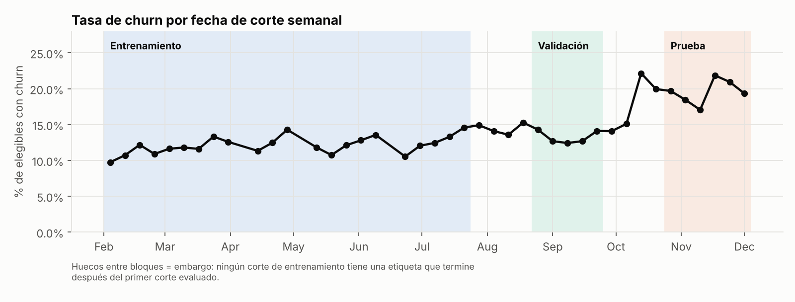
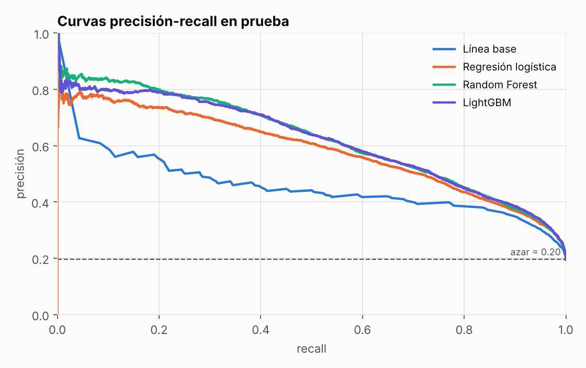

# GamePulse · Proceso completo del componente de aprendizaje automático

> Documento de trabajo del equipo de modelado; la tabla de mejoras de la sección 10 quedó como estaba al escribirlo.
> Después se hicieron cuatro mejoras: intervalos por bootstrap, lift, diagnóstico del nivel máximo (la precisión de
> 0,16 estaba subestimada) y entrenamiento con el oro de Spark (`--oro`). Su estado y las cifras finales están en la
> sección 4.5 del documento (`docs/documento/`).

Este documento explica, de punta a punta, qué hace el pipeline, por qué se tomó cada decisión, dónde está en el
código, qué resultados da, qué se puede mejorar y qué falta. Cifras de la corrida de referencia
(`resultados/referencia/`); se reproducen con `python flows/pipeline_flow.py`.

**Contenido**

1. [El problema como tarea de ML](#1-el-problema-como-tarea-de-ml)
2. [Datos y auditoría de cobertura](#2-datos-y-auditoría-de-cobertura)
3. [Unidad de análisis, población objetivo y etiqueta](#3-unidad-de-análisis-población-objetivo-y-etiqueta)
4. [Variables](#4-variables)
5. [Partición temporal](#5-partición-temporal)
6. [Modelos, selección y evaluación](#6-modelos-selección-y-evaluación)
7. [¿Poblaciones específicas? Lo que se probó](#7-poblaciones-específicas-lo-que-se-probó)
8. [Interpretación y recomendaciones](#8-interpretación-y-recomendaciones)
9. [Orquestación y trazabilidad](#9-orquestación-y-trazabilidad)
10. [Qué llevamos, qué se puede mejorar y qué falta](#10-qué-llevamos-qué-se-puede-mejorar-y-qué-falta)

---

## 1. El problema como tarea de ML

**Pregunta:** cada lunes, entre los personajes que están jugando, ¿cuáles dejarán de aparecer durante los próximos
30 días? Es una **clasificación binaria** con **validación fuera de tiempo**: se entrena con el pasado y se evalúa
con semanas posteriores, como se usaría en la práctica (puntuar cada lunes y priorizar a quién contactar).

La métrica principal es **PR-AUC** (área bajo la curva precisión-recall), porque la clase positiva es minoritaria
(14 %) y lo que importa es ordenar bien a los de mayor riesgo. Se complementa con **precisión y recall en el
10 % de mayor riesgo de cada semana**, que representa una capacidad limitada de intervención.

## 2. Datos y auditoría de cobertura

**Entrada:** capa plata `plata_wowah.parquet` (10.823.177 observaciones de 37.354 personajes, 2008, Horda, un
servidor). Cada fila es "el personaje X estaba conectado en el instante T, en la zona Z, con nivel N y gremio G".

**Validación (tarea `validar-datos`, `src/gamepulse_ml/validacion.py`):** columnas, tipos, nulos, duplicados,
rangos y huella SHA-256. Si algo falla, el flujo se detiene.

**Auditoría (tarea `auditoria-cobertura`, `auditoria.py`):** antes de decir "30 días sin registros = inactivo"
hay que saber si un día sin filas es un jugador ausente o un colector apagado.

| Hallazgo | Valor | Decisión |
|---|---|---|
| Días con datos | 352 de 366 | — |
| Días sin cobertura (< 20 % de la mediana de registros) | 19 | La ventana de la etiqueta cuenta solo días con cobertura |
| Caídas largas del colector | 3–7 abr, 30 abr–6 may (6 días, la mayor), 16–19 may, 13–18 jun | Ninguna fabrica por sí sola 30 días de ausencia |
| Cadencia del colector | ~10 min hasta el 7/11; ~15 min después | El tiempo de juego se mide en horas estimadas, no en filas |
| Mantenimiento | Jueves ~01:00, ~9 h | No afecta: es igual para todos |
| Saltos entre días activos de un personaje | 69 % = 1 día; 92 % ≤ 7; p95 = 13; 2,3 % ≥ 30 | 30 días está muy por encima del ritmo normal de juego |
| Vuelve en los 60 días siguientes tras 30 días ausente | 30 % | La etiqueta mide inactividad prolongada, no abandono definitivo |

## 3. Unidad de análisis, población objetivo y etiqueta

Este es el punto que más conviene tener claro, porque define qué aprende el modelo y qué significan sus métricas.

### 3.1 Unidad de análisis: personaje × fecha de corte

No hay una fila por jugador. Se toma una **"foto" cada lunes** (fecha de corte *t*, del 04/02 al 01/12/2008) y en
cada foto entran los personajes de la población objetivo. Un mismo personaje aparece en todas las fotos en que esté
activo, cada vez con sus variables y su etiqueta de ese momento (mediana: 3 fotos por personaje; el 10 % más
constante aparece en 26 o más). Es el diseño habitual de churn con ventanas: **ventana de observación** (pasado) →
**fecha de corte** → **ventana de desempeño** (futuro, define la etiqueta).

### 3.2 Población objetivo: personajes "en riesgo" en cada corte

Solo tiene sentido predecir el abandono de quien **todavía está jugando**. En cada corte, un personaje es elegible si:

1. **Fue visto al menos una vez en los 7 días previos** a *t* (está activo), y
2. **Tiene al menos 2 días activos en su historial** (no es un personaje de un solo uso), y
3. **No es uno de los 819 IDs inconsistentes** (pueden mezclar personajes distintos).

Quedan fuera, en promedio por corte:

| Grupo | Personajes por corte (promedio) | Por qué no se incluye |
|---|---|---|
| Ausentes > 30 días | 11.943 | Ya cumplen la definición de inactivos: predecirlo no aporta nada |
| Ausentes 8–30 días | 3.757 | Ya se están yendo: una acción de retención llega tarde y son casos fáciles que inflan las métricas |
| Activos con 1 solo día de historia | 462 (3.184 el 13/10 por la ráfaga de nivel 1) | Personajes efímeros: pruebas, alts, la ráfaga del 08/10 |
| **Elegibles (población del modelo)** | **3.826** | **Activos y con historia: los que se pueden retener** |

El detalle por corte está en `embudo_poblacion.csv`, y una prueba automática verifica que cuadra con el dataset
(`tests/test_pipeline.py::test_embudo_cuadra_con_dataset`).

### 3.3 Etiqueta

`churn = 1` si el personaje **no aparece en los 30 días con cobertura** que siguen a *t*. Si en esa ventana hay
días sin cobertura, se alarga en calendario (hasta 39 días). Resultado: 156.877 filas, 18.440 personajes, 41 cortes,
14,1 % de churn. El 37 % de los `churn = 1` reaparece en los 60 días posteriores, por eso se habla de
**inactividad prolongada**.

Se descartan cortes sin 30 días de seguimiento antes del 31/12 y cortes con menos de 5 días cubiertos en la semana
previa (07/04, 05/05 y 16/06). Código: `dataset.py`, tarea `construir-dataset`.

## 4. Variables

37 variables, **todas calculadas solo con datos anteriores a *t***, en ventanas de 7, 14 y 28 días normalizadas
por los días con cobertura.

| Familia | Variables |
|---|---|
| Recencia e historial | `dias_desde_ultima`, `antiguedad_dias`, `antiguedad_censurada`, `dias_activos_hist` |
| Regularidad y tiempo de juego | `frac_dias_activos_{7,14,28}`, `horas_{7,14,28}`, `sesiones_{7,14,28}`, `horas_por_sesion_28`, `horas_por_dia_activo_28`, `frac_finde_28`, `salto_max_28`, `salto_std_28` |
| Cambio reciente | `tendencia_horas`, `tendencia_dias` (última semana vs. 3 anteriores) |
| Progresión | `nivel`, `distancia_al_tope`, `en_tope`, `niveles_ganados_28`, `dias_desde_subida_nivel` (tope 70; 80 desde el 13/11) |
| Zonas y actividad | `n_zonas_28`, `entropia_zonas_28`, `frac_{ciudad,pvp,raid,mazmorra,mundo}_28` |
| Social y perfil | `tiene_gremio`, `cambios_gremio_28`, `tamano_gremio_activo_7`, `clase`, `raza` |

## 5. Partición temporal

La partición es **por fecha de corte, nunca aleatoria**. Una partición aleatoria mezclaría filas del mismo
personaje en semanas consecutivas entre entrenamiento y prueba, y además dejaría entrenar con el futuro.

| Bloque | Cortes | Filas | Personajes | Churn | Para qué se usa |
|---|---|---|---|---|---|
| Entrenamiento | 04/02 – 21/07 (22 cortes) | 87.154 | 12.357 | 12,1 % | Ajustar los modelos |
| Validación móvil 1 | 09/06 – 14/07 (5); entrena con cortes hasta el 28/04 | 18.207 | — | 12,5 % | Elegir hiperparámetros |
| Validación móvil 2 | 21/07 – 18/08 (5); entrena hasta el 09/06 | 18.519 | — | 14,5 % | Elegir hiperparámetros |
| Validación (móvil 3) | 25/08 – 22/09 (5); entrena hasta el 21/07 | 17.849 | 6.283 | 13,2 % | Hiperparámetros + umbral de decisión |
| Prueba | 27/10 – 01/12 (6) | 22.380 | 8.364 | 19,6 % | Una sola evaluación final |

**Cómo se usa, paso a paso:**

1. Cada configuración de hiperparámetros se entrena tres veces (una por bloque de validación móvil), siempre con
   cortes anteriores al bloque, y se promedia su PR-AUC. Gana la de mayor promedio.
2. Con las predicciones del bloque de validación (25/08–22/09) se fija el umbral de decisión (máximo F1).
3. Se reentrena la configuración ganadora con entrenamiento + validación (cortes hasta el 22/09).
4. Se evalúa **una sola vez** en prueba (27/10–01/12). La prueba nunca se usa para decidir nada.

**Embargo:** un corte solo entra a entrenar si su etiqueta (*t* + 30 días con cobertura) ya se conocía el día del
primer corte evaluado. Por eso hay semanas que no entran al entrenamiento de un bloque (p. ej. los cortes del 28/07 al 18/08 no entrenan el modelo que se valida desde el 25/08). El
código lanza `ErrorFugaTemporal` si se viola, y hay una prueba automática.

**El mismo personaje puede estar en entrenamiento y en prueba, en momentos distintos.** Es correcto en un diseño
fuera de tiempo, porque en producción se puntuaría cada semana a jugadores que el modelo ya vio antes. Para
descartar que el modelo "memorice" personajes, se midió aparte el desempeño en los nunca vistos (sección 7).
Del bloque de prueba, el 64 % de los personajes ya aparecía al entrenar y el 23 % de las filas son de nunca vistos.

## 6. Modelos, selección y evaluación

| Modelo | Hiperparámetros elegidos | PR-AUC validación (media ± d.e., 3 bloques) | PR-AUC prueba | ROC-AUC prueba | Precisión@10 % | Recall@10 % | Brier |
|---|---|---|---|---|---|---|---|
| Azar | — | — | 0,196 | 0,500 | 0,196 | 0,10 | — |
| Regla de recencia (línea base) | — | — | 0,450 | 0,806 | 0,504 | 0,258 | — |
| Regresión logística (pesos de clase) | C = 0,01 | 0,469 ± 0,022 | 0,585 | 0,859 | 0,680 | 0,350 | 0,165 |
| Random Forest (pesos de clase) | hoja ≥ 20 | 0,503 ± 0,020 | 0,625 | 0,868 | 0,727 | 0,373 | 0,131 |
| **LightGBM (elegido)** | 15 hojas, lr 0,05, 300 árboles | **0,513 ± 0,024** | 0,618 | 0,869 | 0,722 | 0,371 | 0,110 |
| Ensamble (promedio de rangos) | — | — | 0,623 | 0,870 | 0,719 | 0,370 | — |

- **Selección:** LightGBM tiene la mejor PR-AUC media en validación. En prueba, Random Forest y el ensamble quedan
  a menos de 0,01, una diferencia dentro del ruido (la desviación entre bloques es ~0,02). El ensamble no mejora
  en validación (−0,007), así que se publica el modelo individual, que además es el mejor calibrado (Brier 0,110).
- **Umbral 0,240:** precisión 0,55 y recall 0,66 en prueba (VP 2.905, FP 2.420, FN 1.473, VN 15.582).
- **10 % de mayor riesgo:** el 72 % de ellos efectivamente se va (3,7 veces el azar). Con 19,6 % de churn, el
  recall máximo posible en el 10 % es ~0,50; LightGBM logra 0,37.
- **Estabilidad:** PR-AUC entre 0,59 y 0,65 en los 6 cortes de prueba, también después de la expansión (13/11).
- **Ablación:** sin las variables que dependen del inicio del dataset, PR-AUC 0,611 (−0,007).

## 7. ¿Poblaciones específicas? Lo que se probó

La pregunta es legítima: en churn, la población define qué se aprende. Se probaron tres cosas.

### 7.1 Definiciones alternativas de la población (flujo `gamepulse-sensibilidad-etiqueta`)

| Escenario | Elegibles por corte | Churn | PR-AUC en su propia población | PR-AUC sobre la población base |
|---|---|---|---|---|
| **Base: activos en 7 días, ≥ 2 días de historia** | 3.826 | 14,1 % | 0,618 | **0,618** |
| Ampliada: activos en 14 días | 4.823 | 20,6 % | 0,710 | 0,622 |
| Ampliada: incluye personajes de 1 día | 4.288 | 21,0 % | 0,780 | 0,622 |

Las poblaciones amplias **parecen** mejores (0,71 y 0,78), pero solo porque agregan casos fáciles: jugadores que ya
llevan 8–14 días fuera o personajes efímeros que casi nunca vuelven. Sobre los mismos jugadores de la población
base, el modelo rinde igual (0,622 frente a 0,618). Ampliar la población infla la métrica sin mejorar la
predicción donde sí sirve actuar. **Se mantiene la población base.**

### 7.2 Desempeño del modelo único por subpoblación (prueba)

| Subpoblación | Filas | Churn | PR-AUC | Lift sobre azar | Precisión@10 % dentro del grupo |
|---|---|---|---|---|---|
| Todos | 22.380 | 19,6 % | 0,618 | 3,2x | 0,72 |
| Jugadores nunca vistos al entrenar | 5.128 | 36,6 % | 0,748 | 2,0x | 0,82 |
| Jugadores ya vistos al entrenar | 17.252 | 14,5 % | 0,477 | 3,3x | 0,54 |
| Nuevos (< 28 días de antigüedad) | 3.564 | 33,9 % | 0,730 | 2,2x | 0,79 |
| Establecidos (≥ 28 días) | 18.816 | 16,8 % | 0,563 | 3,3x | 0,64 |
| Vistos el día anterior al corte | 11.340 | 8,9 % | 0,478 | 5,4x | 0,48 |
| Ausentes 2–3 días | 5.740 | 24,1 % | 0,625 | 2,6x | 0,77 |
| Ausentes 4–7 días | 5.300 | 37,6 % | 0,669 | 1,8x | 0,79 |
| En nivel máximo | 5.893 | 5,9 % | 0,282 | 4,8x | 0,16 |
| Subiendo de nivel | 16.487 | 24,4 % | 0,641 | 2,6x | 0,76 |
| Sin gremio | 7.163 | 33,5 % | 0,681 | 2,0x | 0,78 |
| Con gremio | 15.217 | 13,0 % | 0,526 | 4,0x | 0,55 |
| Antes de la expansión | 11.207 | 18,5 % | 0,629 | 3,4x | 0,72 |
| Después de la expansión | 11.173 | 20,7 % | 0,609 | 3,0x | 0,72 |

- La PR-AUC depende de la tasa de churn de cada grupo; para comparar grupos, miren el **lift** (PR-AUC ÷ churn) y
  el ROC-AUC (`desempeno_por_subpoblacion.csv`).
- **Nunca vistos:** ROC-AUC 0,864 frente a 0,848 en los ya vistos. El modelo generaliza a jugadores nuevos; no
  depende de haberlos visto.
- **Punto débil: personajes en nivel máximo.** Su churn es bajo (5,9 %) y dentro del grupo el 10 % priorizado solo
  acierta el 16 %. Es donde más rinde agregar variables específicas (ver mejoras).

### 7.3 Un modelo por subpoblación frente al modelo global

| Subpoblación | PR-AUC modelo global | PR-AUC modelo entrenado solo con esa subpoblación | Diferencia |
|---|---|---|---|
| Nuevos (< 28 días) | 0,730 | 0,733 | +0,002 |
| Establecidos (≥ 28 días) | 0,563 | 0,561 | −0,002 |
| En nivel máximo | 0,282 | 0,271 | −0,010 |
| Subiendo de nivel | 0,641 | 0,636 | −0,004 |
| Sin gremio | 0,681 | 0,673 | −0,009 |
| Con gremio | 0,526 | 0,529 | +0,003 |

Los modelos especializados no mejoran: el modelo global ya distingue las subpoblaciones a través de sus variables
(`antiguedad_dias`, `en_tope`, `tiene_gremio`). **Se mantiene un solo modelo.**

## 8. Interpretación y recomendaciones

- **SHAP (`importancia_shap_prueba.csv`):** dominan la regularidad y la recencia (`frac_dias_activos_28`,
  `dias_desde_ultima`, `frac_dias_activos_7`, `dias_activos_hist`); la progresión aporta menos.
- **Perfiles K-Means (k = 5, ajustado en entrenamiento):** dos perfiles concentran el riesgo, ambos sin gremio y con
  progresión estancada (33–34 % de churn); los tres perfiles con gremio tienen 5–7 %. La silueta es baja (0,22–0,24):
  son una segmentación útil para actuar, no grupos naturales.
- **Matriz de recomendaciones (`matriz_recomendaciones.csv`):** perfil → prioridad → rasgos → acción posible →
  cómo evaluarla. Cada jugador en `scores_prueba.parquet` trae sus 3 señales principales (SHAP) y una acción
  sugerida. **Las acciones son hipótesis:** los datos son observacionales y no muestran qué acción evita el
  abandono; habría que probarlas con un experimento controlado.

## 9. Orquestación y trazabilidad

Todo corre como el flujo de Prefect `gamepulse-churn` (15 tareas, ~10 min). Cada corrida queda en el dashboard
con estado, duración, logs y artefactos, y en `runs/<fecha>_<nombre>/` con parámetros, hash de datos, versiones,
modelos, métricas y figuras. Hay controles que detienen la corrida: datos inválidos, fuga temporal o un modelo que
no supera a la línea base. Guía: [prefect.md](prefect.md).

| Tarea | Qué produce |
|---|---|
| `validar-datos` | Controles de calidad y SHA-256 |
| `auditoria-cobertura` | Cobertura, huecos, saltos, tasa de retorno |
| `construir-dataset` | Población + variables + etiqueta (se reutiliza si no cambian datos ni configuración) |
| `particion-temporal` | Bloques y verificación de embargo |
| `linea-base`, `entrenar-*`, `evaluar-ensamble` | Modelos y métricas |
| `seleccionar-y-control-de-calidad` | Modelo elegido por validación |
| `interpretar-y-recomendar` | SHAP, K-Means, matriz, scores por jugador |
| `analizar-poblacion` | Embudo, panel, subpoblaciones, modelos especializados |
| `ablacion-variables-censuradas`, `figuras`, `registrar-corrida` | Ablación, figuras, ficha e historial |

## 10. Qué llevamos, qué se puede mejorar y qué falta

### Qué llevamos (componente de ML)

- Datos validados y auditados; etiqueta justificada con la auditoría y con sensibilidad de horizonte y población.
- Población objetivo explícita, con embudo verificado.
- Partición fuera de tiempo con embargo y validación móvil, con controles automáticos de fuga.
- Tres familias de modelos, línea base y ensamble; evaluación global, por corte y por subpoblación.
- Interpretación (SHAP), segmentación (K-Means) y matriz de recomendaciones.
- Todo orquestado y trazable en Prefect, con 10 pruebas automáticas y resultados de referencia versionados.

### Qué se puede mejorar (en orden de impacto esperado)

| # | Mejora | Por qué | Esfuerzo |
|---|---|---|---|
| 1 | Variables de "fin de juego" para personajes en nivel máximo (tendencia de raids, días desde la última raid, actividad del gremio en raids) | Es la subpoblación con peor desempeño (precisión@10 % de 0,16 dentro del grupo) | Medio |
| 2 | Intervalos de confianza por bootstrap agrupado por personaje | Para afirmar si 0,618 vs 0,625 es una diferencia real o ruido | Bajo |
| 3 | Priorizar por top-K semanal en vez de un umbral fijo, y recalibrar las probabilidades | El churn sube de ~13 % a ~20 % en prueba; el umbral de validación deja de ser óptimo | Bajo |
| 4 | Monitoreo de deriva de variables (PSI) como tarea de Prefect | La expansión cambia el comportamiento; avisaría cuándo reentrenar | Bajo |
| 5 | Formulación de supervivencia (tiempo hasta la inactividad) como modelo complementario | Usa mejor los datos censurados al final de 2008 y responde "cuándo", no solo "si" | Alto |
| 6 | Segmentación alternativa (reglas de negocio o mezcla gaussiana) | La silueta de K-Means es baja | Medio |
| 7 | Búsqueda de hiperparámetros más amplia (p. ej. Optuna) | Ganancia esperada pequeña: la variación entre bloques (~0,02) supera las diferencias entre configuraciones | Medio |

### Limitaciones que hay que declarar

- La etiqueta es por **personaje**, no por cuenta: un jugador puede dejar un personaje y seguir con otro (el perfil
  "aparcado en ciudad" sugiere personajes secundarios). Los datos no traen un identificador de cuenta.
- Inactividad prolongada ≠ abandono definitivo (37 % de los etiquetados vuelve en 60 días).
- La prueba cae en un cambio de régimen (parche 3.0.2 el 14/10, expansión el 13/11).
- Solo 2008, solo Horda, un servidor: no se generaliza a otros juegos sin validación externa.

### Entrega

El documento final consolida estas secciones con la ingeniería de datos en AWS (sección 5) y el tablero
(sección 6); está en `docs/documento/`.
